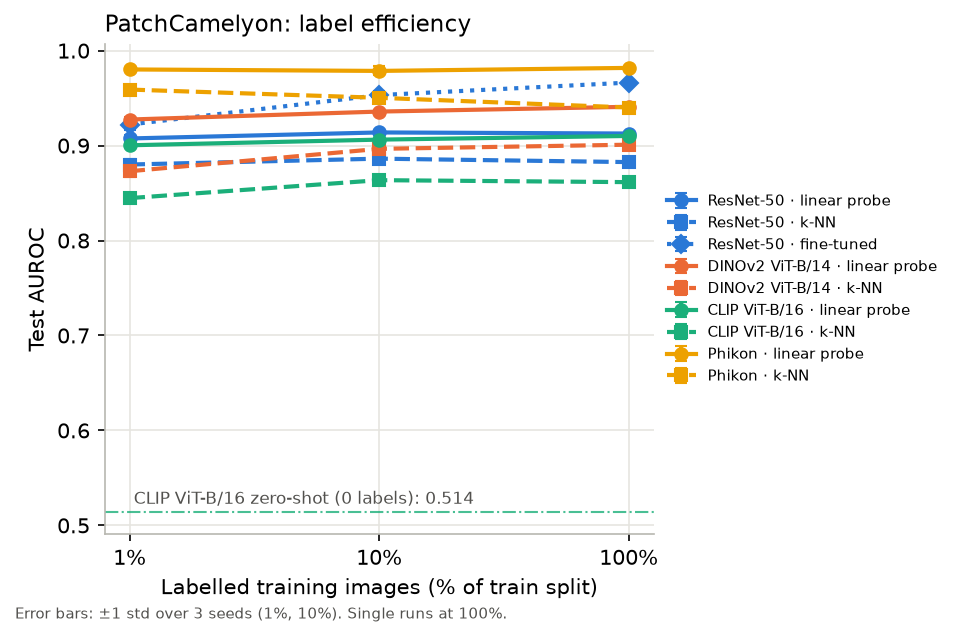
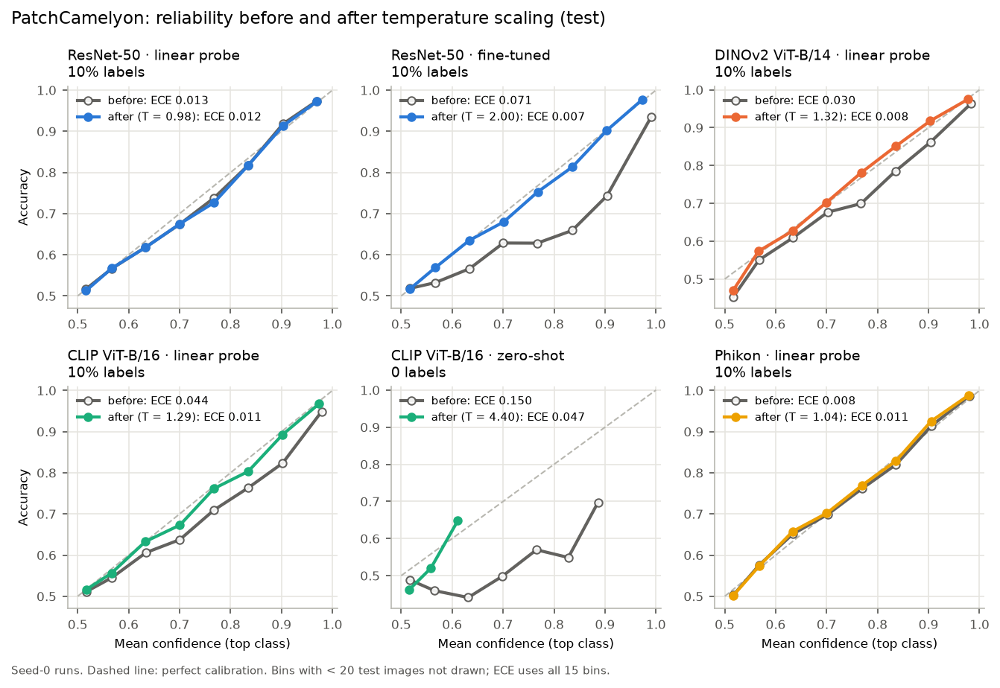
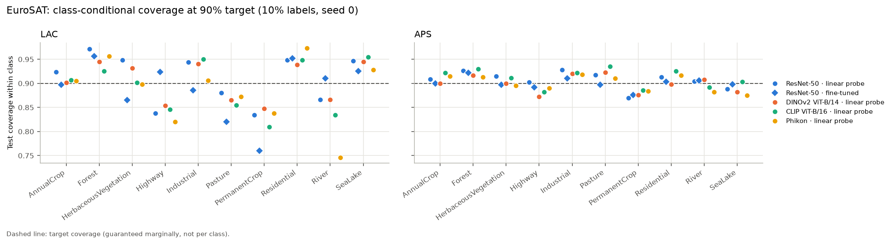
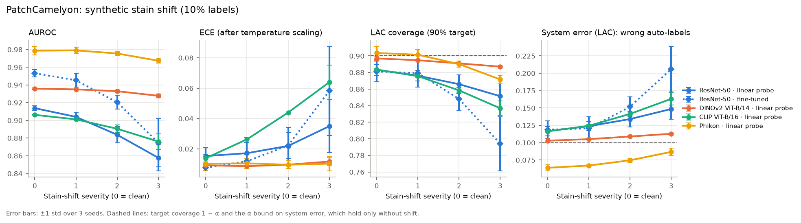
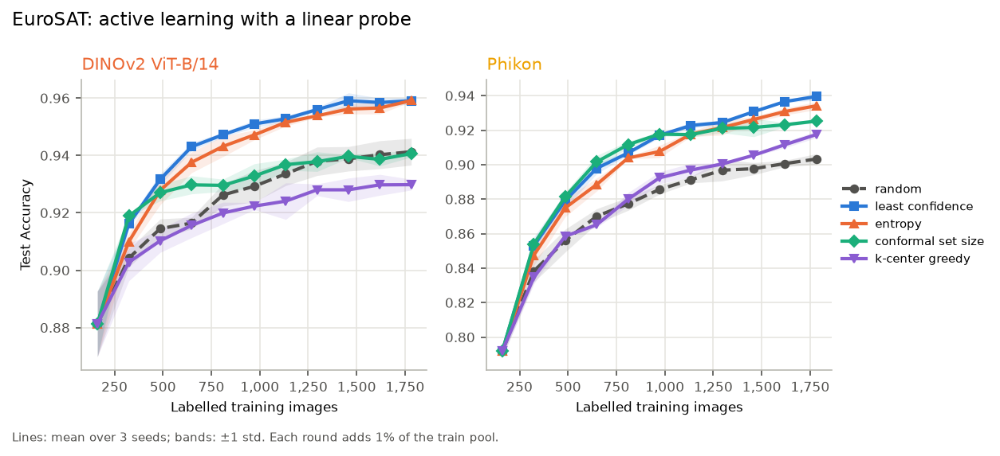

# LabelLite

How far can you get on histopathology and satellite images when you only have a handful of
labels? LabelLite is a small, config-driven pipeline for answering that with frozen vision
foundation models. It pulls features from four backbones, trains linear probes and k-NN on top,
and compares them to a fully fine-tuned ResNet-50. It then checks whether the resulting
confidences can be trusted: temperature scaling, split-conformal triage, a synthetic stain-shift
test, simulated active learning and Grad-CAM error galleries.

The two datasets are PatchCamelyon (lymph-node tissue patches, tumor vs. normal) and EuroSAT
(Sentinel-2 land cover, 10 classes). Every number in this README is produced by the code in the
repo. The headline figures are regenerated by `labellite headline` into
[results/tables/headline.md](results/tables/headline.md), so nothing here is typed in by hand.

The original plan is in [PROJECT_2_SPEC.md](PROJECT_2_SPEC.md). Three things changed along the
way. Camelyon17-WILDS had to be dropped because its download host was serving an expired TLS
certificate, so the distribution-shift experiment uses a synthetic stain shift instead. Phikon
replaces the gated pathology models (UNI, CONCH). And the planned web app was cut; errors are
reviewed through static galleries and a CSV sheet.

The write-up is a 4-page report in [report/](report/) (`report/labellite.pdf`).

## Short answers

**Do frozen features plus a linear probe match a fine-tuned CNN with few labels?** On PCam,
easily: Phikon with 1% of the labels (accuracy 0.925, AUROC 0.980) beats a ResNet-50 fine-tuned
on all of them (0.886, 0.966). On EuroSAT the frozen features get close but don't win. At 10%
labels the best probe reaches 95.5% of the fine-tuned model's accuracy (0.939 vs. 0.984).

**Are the confidences calibrated?** Mostly, once there are enough labels. From 10% labels up,
the probes have ECE of at most 0.035 before any correction. The bad cases are the fine-tuned
ResNet-50 on PCam (ECE 0.115 at 1% labels) and both ResNet-50 variants on EuroSAT at 1% labels
(0.148 and 0.150). Temperature scaling brings all of those down to 0.017–0.028.

**Can conformal triage auto-label safely?** On PCam at a 95% coverage target with 10% labels,
Phikon plus LAC auto-labels 90.1% of test patches, with 4.7% error among those. The catch is
that PCam's calibration and test splits come from different slides, and coverage misses its
target by up to 4.7 points because of it.

**What happens under a stain shift?** Everything gets worse, but by very different amounts. The
fine-tuned ResNet-50 drops from 88.1% to 79.4% coverage at a 90% target; frozen DINOv2 barely
moves (89.7% to 88.7%).

**Does uncertainty sampling save labels?** On EuroSAT, yes: least-confidence sampling reaches
random sampling's final accuracy with 58–65% fewer labels. On PCam, nothing beats random,
because performance is already flat at 1% labels.

## Backbones

| Name | Weights | Feature | License |
|---|---|---|---|
| `resnet50` | timm `resnet50.tv2_in1k` (ImageNet-1k) | 2048-d, global average pool | BSD-3-Clause |
| `dinov2_vitb14` | timm `vit_base_patch14_dinov2.lvd142m` | 768-d, CLS token | Apache-2.0 |
| `clip_vitb16` | open_clip `ViT-B-16`, OpenAI weights (QuickGELU) | 512-d, projected image embedding | MIT |
| `phikon` | Hugging Face `owkin/phikon` (pinned revision) | 768-d, CLS token | Owkin non-commercial |

Phikon is a ViT-B/16 pretrained with iBOT on TCGA slides, so none of the Camelyon slides behind
PCam were in its pretraining data. It stands in for UNI and CONCH, which need an institutional
account. Its license allows non-commercial research use and refers to non-profit entities.

All weights are downloaded from their official sources at run time and never redistributed.
Dataset sources, licenses and measured sizes are documented in [data/DATASETS.md](data/DATASETS.md).

Images are resized to 224 × 224 without cropping and normalized with each model's own mean and
std. Features are cached as float16 under `data/cache/features/<model>/<dataset>/`. The cache
key covers the model, weights hash, preprocessing, dataset and split hash, so if any of those
change the cache is rebuilt rather than silently reused.

## Results

Everything is measured on held-out test splits: 32,768 PCam patches and 5,400 EuroSAT images.
The 1% and 10% budgets are averaged over 3 label-subset seeds (mean ± std); the 100% budget is a
single run with a 95% bootstrap CI.

### Label efficiency

| Model | Method | PCam AUROC 1% | 10% | 100% | EuroSAT acc. 1% | 10% | 100% |
|---|---|---|---|---|---|---|---|
| ResNet-50 | linear probe | 0.907 ± 0.004 | 0.914 ± 0.002 | 0.913 | 0.870 ± 0.001 | 0.939 ± 0.002 | 0.966 |
| ResNet-50 | fine-tuned | 0.922 ± 0.006 | 0.953 ± 0.004 | 0.966 | 0.865 ± 0.001 | 0.968 ± 0.002 | **0.984** |
| DINOv2 ViT-B/14 | linear probe | 0.927 ± 0.003 | 0.936 ± 0.001 | 0.941 | **0.880 ± 0.012** | 0.939 ± 0.002 | 0.965 |
| CLIP ViT-B/16 | linear probe | 0.900 ± 0.002 | 0.906 ± 0.001 | 0.910 | 0.862 ± 0.007 | 0.930 ± 0.003 | 0.958 |
| CLIP ViT-B/16 | zero-shot | 0.514 (no labels) | | | 0.504 (no labels) | | |
| Phikon | linear probe | **0.980 ± 0.001** | **0.979 ± 0.005** | **0.982** | 0.792 ± 0.003 | 0.904 ± 0.004 | 0.952 |

The full tables, with accuracy, macro-F1, balanced accuracy, k-NN and CIs, are in
[main_results_pcam.md](results/tables/main_results_pcam.md) and
[main_results_eurosat.md](results/tables/main_results_eurosat.md).

The domain-specific model only wins in its own domain. Phikon is the best model on PCam at every
budget and the weakest probe on EuroSAT. Fine-tuning, on the other hand, needs labels to pay
off: with 1% of them the fine-tuned ResNet-50 is no better than a linear probe on DINOv2. CLIP
zero-shot sits at chance on both datasets (accuracy 0.488 on PCam, 0.504 on EuroSAT) with the
prompts in [configs/zeroshot.yaml](configs/zeroshot.yaml), which probably says as much about the
prompts as about CLIP.

Paired tests on the seed-0 runs, Holm-corrected, are in
[paired_tests.md](results/tables/paired_tests.md). On PCam at 100% labels, Phikon's probe is more
accurate than the fine-tuned ResNet-50 (+0.038, McNemar p < 0.001). The paired bootstrap on the
AUROC gap (+0.016) only reaches p = 0.072. That's a resolution limit rather than a real null:
with 1,000 resamples the smallest possible raw p-value is about 0.002, and multiplying by the
Holm family size pushes it to roughly 0.07.



### Calibration

The temperature is fitted on one half of the calibration split; ECE (15 bins), Brier score and
NLL before and after are in [calibration_pcam.md](results/tables/calibration_pcam.md) and
[calibration_eurosat.md](results/tables/calibration_eurosat.md). Temperature scaling matters
where a model is clearly off:

| ECE | before | after |
|---|---|---|
| PCam, fine-tuned ResNet-50, 1% labels | 0.115 ± 0.014 | 0.028 ± 0.005 |
| PCam, fine-tuned ResNet-50, 100% labels | 0.056 | 0.010 |
| EuroSAT, fine-tuned ResNet-50, 1% labels | 0.150 ± 0.017 | 0.024 ± 0.007 |
| EuroSAT, ResNet-50 linear probe, 1% labels | 0.148 ± 0.113 | 0.017 ± 0.007 |

Phikon on PCam is already well calibrated (0.007–0.013) and stays that way after scaling
(0.010–0.014).



### Conformal triage

Each test image gets a prediction set. If the set contains exactly one class, the image is
auto-labeled; otherwise it goes to an expert. Conformal prediction is calibrated on the other
half of the calibration split, using temperature-scaled probabilities. Full tables:
[conformal_pcam.md](results/tables/conformal_pcam.md) and
[conformal_eurosat.md](results/tables/conformal_eurosat.md).

Here is the frozen probe with the largest auto-labeled share at each target, with 10% labels:

| Dataset | Target | Probe | Score | Coverage | Auto-labeled | Error among auto-labeled | System error |
|---|---|---|---|---|---|---|---|
| PCam | 95% | Phikon | LAC | 95.8% | 90.1% | 4.7% | 4.2% |
| PCam | 90% | Phikon | LAC | 90.4% | 96.8% | 6.6% | 6.4% |
| EuroSAT | 95% | CLIP ViT-B/16 | LAC | 94.7% | 95.5% | 5.1% | 4.9% |
| EuroSAT | 90% | Phikon | LAC | 89.3% | 97.0% | 8.2% | 7.9% |

System error is the number of wrong auto-labels divided by all images; it's bounded by α only if
the expert never makes mistakes. APS is the more cautious option: for Phikon on PCam at 95% it
auto-labels 73.3% of images at 3.4% error.

On EuroSAT, coverage lands within 3 standard deviations of its expected value in all 144
(run, score, α) combinations. On PCam it does so in only 94 of 144, with deviations from −4.7 to
+1.3 points. The reason is that PCam's calibration split is the official validation set and the
test set comes from different slides, so the two aren't exchangeable. Calibrating on a random
half of the test set instead brings it back to 144 of 144.



### Synthetic stain shift

The PCam test patches are perturbed in Ruifrok–Johnston stain space: at severity *s*,
hematoxylin is scaled by (1 − 0.15·*s*) and eosin by (1 + 0.25·*s*). Models, temperatures and
conformal thresholds all stay as they were fitted on clean images. With 10% labels and LAC at a
90% target:

| Model | AUROC s = 0 → 3 | Coverage s = 0 → 3 |
|---|---|---|
| ResNet-50 fine-tuned | 0.953 → 0.875 | 88.1% → 79.4% |
| CLIP ViT-B/16 linear probe | 0.906 → 0.876 | 88.4% → 83.7% |
| ResNet-50 linear probe | 0.914 → 0.858 | 88.3% → 85.1% |
| Phikon linear probe | 0.979 → 0.967 | 90.4% → 87.2% |
| DINOv2 ViT-B/14 linear probe | 0.936 → 0.928 | 89.7% → 88.7% |

At the worst severity the fine-tuned model's system error goes from 11.9% to 20.6%. Per-severity
ECE, APS and auto-labeled share are in [shift_pcam.md](results/tables/shift_pcam.md). Keep in
mind this is a synthetic perturbation, not a real change of hospital or scanner.



### Active learning

Each run starts from the 1% label subset and adds 1% of the training pool per round for 10
rounds. The classifier is a linear probe on DINOv2 or Phikon features, with C re-selected on the
validation set every round, and every strategy is run with 3 seeds. Tables:
[active_learning_eurosat.md](results/tables/active_learning_eurosat.md) and
[active_learning_pcam.md](results/tables/active_learning_pcam.md).

| Dataset · model | Random (final) | Best strategy (final) | Labels to reach random's final score |
|---|---|---|---|
| EuroSAT · DINOv2 (accuracy) | 0.941 ± 0.005 | least confidence 0.959 ± 0.001 | 623 vs 1,782 (65% fewer) |
| EuroSAT · Phikon (accuracy) | 0.903 ± 0.003 | least confidence 0.940 ± 0.002 | 746 vs 1,782 (58% fewer); conformal set size: 675 (62% fewer) |
| PCam · DINOv2 (AUROC) | 0.937 ± 0.003 | none better | uncertainty strategies end at 0.935 |
| PCam · Phikon (AUROC) | 0.982 ± 0.000 | none better | least confidence 0.975, k-center 0.965 |

k-center greedy (core-set selection) came last in three of the four settings.



### Explanations and failure modes

Grad-CAM maps are computed for all five models; for the ViTs they use the patch tokens going
into the last block. See [explanations_pcam.png](results/figures/explanations_pcam.png) and
[explanations_eurosat.png](results/figures/explanations_eurosat.png), and
[results/error_gallery/](results/error_gallery/) for each model's confident errors and most
uncertain images. Treat the maps as a rough visual aid, not proof of what a model "looks at".

The most common errors of the reference probes (10% labels, seed 0) are in
[headline.md](results/tables/headline.md). On PCam, 87.3% of Phikon's 2,491 errors are missed
tumor patches. On EuroSAT, DINOv2 mostly mixes up AnnualCrop and PermanentCrop (55 of 320
errors) and Highway and River (37).

On top of that, 100 randomly sampled test errors per dataset were tagged by failure type, from
each image and its Grad-CAM map. The sheets are in `results/error_gallery/<dataset>/review/review_sample.csv`
and the tallies in [review_pcam.md](results/tables/review_pcam.md) and
[review_eurosat.md](results/tables/review_eurosat.md). Nobody with pathology or remote-sensing
training was involved, so read these as what a non-expert can see in the images:

| PCam (Phikon) | Count | EuroSAT (DINOv2) | Count |
|---|---|---|---|
| ambiguous (no visible tumor evidence) | 57 | look-alike class | 62 |
| model error (visible larger-cell clusters missed) | 17 | ambiguous (mixed scene) | 16 |
| small or edge region | 10 | model error | 13 |
| artifact or blur | 7 | small or edge region | 5 |
| label noise (adipose center, likely coarse annotation) | 7 | label noise | 2 |
| stain or color | 2 | haze or color cast | 2 |

The PCam half in particular would benefit from an expert pass. To redo it, overwrite the
`failure_type` and `notes` columns and run `labellite review --sheet ...`.

## Setup

You need [uv](https://docs.astral.sh/uv/). PyTorch comes from the PyTorch wheel index, so pick
exactly one extra:

```bash
uv sync --extra gpu   # CUDA 13.0 wheels
uv sync --extra cpu   # CPU-only (CI)
```

A plain `uv run` re-syncs without an extra and swaps the torch build out from under you, so
always pass the same extra (`uv run --extra gpu labellite ...`) or use `uv run --no-sync`.

On Windows, keep the checkout at a short path or enable long paths; the CUDA wheels contain DLL
paths longer than the 260-character `MAX_PATH` limit when nested deeply.

None of the models used here need a token. If you add a gated one, copy `.env.example` to `.env`
and set `HF_TOKEN`.

## Reproducing the results

One script runs the whole pipeline in order, from downloads and splits through feature
extraction, training, analysis, conformal prediction, the shift test, active learning,
explanations and the headline numbers:

```bash
bash scripts/reproduce.sh
```

You'll need a CUDA GPU (these results came from a single 8 GB RTX 5070) and about 21 GB of disk.
Anything already downloaded, extracted or trained is reused.

To run individual steps:

```bash
uv run --extra gpu labellite data download --config configs/datasets/eurosat.yaml
uv run --extra gpu labellite data splits   --config configs/datasets/eurosat.yaml
uv run --extra gpu labellite extract   --config configs/extract/dinov2_pcam.yaml
uv run --extra gpu labellite probe     --config configs/main.yaml
uv run --extra gpu labellite finetune  --config configs/finetune/resnet50_pcam.yaml
uv run --extra gpu labellite analyze
uv run --extra gpu labellite conformal --config configs/main.yaml
uv run --extra gpu labellite shift     --config configs/shift.yaml
uv run --extra gpu labellite activelearn --config configs/al.yaml
uv run --extra gpu labellite explain   --config configs/main.yaml
uv run --extra gpu labellite review    --sheet results/error_gallery/pcam/review/review_sample.csv
uv run --extra gpu labellite headline
```

`probe`, `conformal`, `analyze`, `review` and `headline` run on the CPU from cached features and
saved predictions. `extract`, `finetune`, `shift` and `explain` need the GPU. `activelearn` is
mostly CPU and only uses the GPU for k-center greedy.

A few details that matter if you want identical numbers:

- Active-learning runs pin BLAS to 4 threads. At large C the fitted probe weights change in the
  last digits with the thread count, which is enough to flip which C wins on validation.
- The fine-tuned ResNet-50 always runs in bf16, the precision it was trained in. In fp32 its
  probabilities differ by up to 0.75 on some EuroSAT images.
- The `cal` split is divided 50/50 (stratified, seed 0): one half fits the temperature, the other
  calibrates conformal prediction, so the conformal scores don't depend on the data used to
  calibrate them.

## Development

```bash
uv run --extra gpu pytest
uv run --extra gpu ruff check .
uv run --extra gpu ruff format --check .
```

CI runs the same three commands with CPU-only torch.

## Limitations

PCam's patch-level labels are a big simplification of real pathology, where diagnosis happens
per slide and depends on context. EuroSAT images are only 64 × 64 and get upsampled to 224 px.

The stain shift is synthetic. The cross-hospital test I originally planned (Camelyon17-WILDS)
couldn't be downloaded, so RQ4 says nothing about real scanner or hospital differences.

Conformal guarantees assume calibration and test data are exchangeable. PCam's own splits
already break that assumption, and the shift experiment shows how much worse it gets.

The fine-tuned baseline uses one fixed recipe per dataset, and only ResNet-50 was fine-tuned.
Fine-tuned models aren't part of the active-learning study either, and the active-learning
"expert" is just the dataset label; real annotators are slower, disagree with each other and get
tired.

Grad-CAM maps can mislead. The ViT maps are coarse (a 14 × 14 or 16 × 16 patch grid) and depend
on which layer you pick.

There are only three seeds per budget, the 1% and 10% subsets differ only in which images get
labeled, and the pairwise tests use seed 0 only.

## Ethics

This is a research benchmark on public data. It is not a diagnostic tool, and the pathology
results make no clinical claim: a high patch-level AUROC says nothing about clinical
usefulness. It's also worth noting that the dominant PCam error is a missed tumor (87% of the
reference model's errors), which is the costly direction in a clinical setting.

Conformal coverage is not a safety guarantee. It holds on average over images, under
exchangeability, and it breaks under shift.

The models and datasets keep their own licenses: Phikon is non-commercial, EuroSAT is MIT on
Copernicus Sentinel-2 data, and PCam is CC0 according to its README. No weights, raw data or
dataset images are committed, only split ID files, result tables and the figures made from them.
